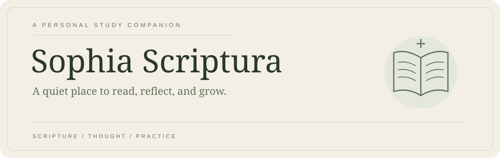

<p align="center">
  <picture>
    <source media="(prefers-color-scheme: dark)" srcset="docs/assets/readme/sophia-dark.svg">
    <source media="(prefers-color-scheme: light)" srcset="docs/assets/readme/sophia-light.svg">
    
  </picture>
</p>

<p align="center">
  A personal, offline-first Bible study workspace for iPad.<br>
  Scripture, handwritten thought, and thoughtful study — together.
</p>

<p align="center">
  <a href="https://github.com/work-w-chrstnrpj/sophia_scriptura/releases/latest">Latest release</a> ·
  <a href="docs/README.md">Explore the wiki</a> ·
  <a href="docs/deployment/deployment.md">Run on iPad</a> ·
  <a href="docs/releases/README.md">Release history</a>
</p>

<p align="center">
  <a href="https://github.com/work-w-chrstnrpj/sophia_scriptura/actions/workflows/release.yml"></a>
  <br>
  <sub>SwiftUI · PencilKit · iPadOS 17+ · Local-first · Bring your own AI key</sub>
</p>

---

## A slower, deeper kind of study

Sophia Scriptura brings the Bible and your study materials into one personal space.
Read a passage, write in the margins, follow a question, and keep what you discover
anchored to Scripture. Its study companion is guided by historic orthodox Christian
conviction, while interpretation and discernment remain the reader’s responsibility.

Built for one person’s iPad, not as a hosted service or an App Store product.

## Your study, connected

| Space | What you can do |
| :--- | :--- |
| **Scripture** | Read bundled WEB offline, annotate with Apple Pencil, select text, save passages and open verse or chapter study hubs. |
| **Collections** | Gather bookmarks, gleanings, links, notes and conversations into personalized, nested folders. |
| **Notes** | Work in Canvas, Page, Prayer or Journal notes with typed content, ink and study references. |
| **Companion** | Ask your own verse-linked questions, explore original-language wording, revisit conversations and use Quiz Me. |
| **Activity** | Record study sessions, follow reading habits, set reminders and enter meditation journeys. |
| **Settings** | Personalize appearance and your profile, manage providers, and access archives, Trash and data controls. |

### From a passage to a personal insight

Read → select a verse → ask or annotate → save an insight → revisit it in context.

Verse Hub brings related study items together. Chapter Hub groups chapter conversations,
verse conversations and links without sending the entire chapter to an AI provider.
Original Language Analysis distinguishes a selected word from a phrase or sentence.

## Local first. Online by choice.

- **Offline foundation:** bundled Scripture and local study storage. Licensed editions
  have separate availability, synchronization and content-rights rules.
- **Explicit AI requests:** Companion uses your configured provider and key. Sending a
  question transmits its disclosed, authorized context; it is not offline AI.
- **Keys stay out of Git:** provider credentials belong in device Keychain, never in
  repository files, screenshots or release attachments.
- **Sources need discernment:** links and model-generated references are not proof of
  retrieval or accuracy. Check quotations, lexical claims and interpretations independently.

## Make it yours

1. Clone this repository and open
   `application/SophiaScriptura/SophiaScriptura.xcodeproj` in Xcode.
2. Choose the **SophiaScriptura** scheme and configure your **Personal Team** under
   Signing & Capabilities.
3. Select your connected, trusted iPad and run the app.
4. Configure appearance and, optionally, your AI provider in Settings.

Follow the [full deployment guide](docs/deployment/deployment.md) for signing and device
setup. Personal free-account signing generally requires weekly redeployment. Releases
contain source, not an installable IPA. Upgrade in place and keep available backups;
uninstalling can remove local study data.

<details>
<summary><strong>Release health & verification</strong></summary>

The [version history](docs/releases/README.md) records each release’s scope and checks.
The workflow badge above reports **main’s workflow**, not every local test or device check;
it may show no status until the workflow exists and runs on that branch. Private-repository
badges are not publicly accessible outside GitHub.

`v0.2.0` (build 16) is the current app version. Its full unit suite passed (210 tests,
including 34 Notes tests). Earlier development builds were installed on the paired iPad;
the final source verification does not cover UI automation or live Pencil feel.
The earlier `v0.1.0` publication recorded a blocked unit suite;
later CI repair on `main` is documented separately.

See [v0.2.0 notes](docs/releases/v0.2.0.md), [v0.1.0 notes](docs/releases/v0.1.0.md), and the
[test specification](docs/testing/test-specification.md).
Scripture narration is excluded from this release.

</details>

<details>
<summary><strong>Inside the repository</strong></summary>

```text
application/   Native SwiftUI app, domain contracts, local stores and XCTest targets
service/       Local Scripture import and validation tools — no runtime backend
shared/        Shared seed data
docs/          Project wiki: intent, design, contracts, testing and releases
tickets/       Bounded work, acceptance criteria and verification evidence
.agents/       Canonical AI roles and reusable workflows
```

[Technical design](docs/tdd/tdd.md) ·
[Source structure](docs/project-structure/project-structure.md) ·
[Backward compatibility](docs/guidelines/backward-compatibility.md)

</details>

<details>
<summary><strong>Development & documentation</strong></summary>

Work is owner-directed: select a ticket, define the visible outcome, implement it, and
record the evidence. Ready tickets are not automatic permission to start new features.

[Roadmap](docs/development-plan/development-plan.md) ·
[Tickets](tickets/README.md) ·
[Product specification](docs/product-specification/product-specification.md) ·
[Development guidelines](docs/guidelines/ai-structure-guidelines.md)

README artwork lives in `docs/assets/readme/`. GitHub selects the light/dark variant
automatically; the workflow badge updates from Actions and the latest-release link follows
the published release. No script, external stats service or secret-bearing image URL is needed.

</details>

---

<p align="center"><em>Read with attention. Study with humility. Return with purpose.</em></p>

Created by Christian Paje. Licensed under [GPL-3.0-or-later](LICENSE).
Scripture, fonts and other bundled third-party assets retain their respective notices
and permissions; the app license does not override those rights.
