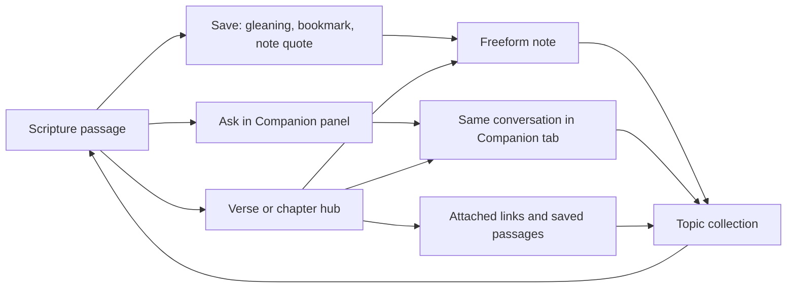

# UX Specification — Sophia Scriptura

Status: full-app interaction proposal, reconciled 2026-09-16; owner review pending. Requirements: [product specification](../product-specification/product-specification.md).
Technical constraints: [TDD](../tdd/tdd.md). The owner requires free placement of text,
ink, and images and has selected expandable canvas after the interactive comparison.
That choice is confirmed; the detailed interactions below remain proposals.

## Whole-app experience to review before further coding

The [full-design reconciliation](../product-specification/product-specification.md#full-design-reconciliation--review-baseline)
preserves the original brief and maps each feature to proposed delivery stages. This UX
page describes the intended connected experience; the existing sample proves only a
small part of the canvas. OldPaper is the owner-selected visual baseline; complete feature
screens, detailed navigation, accessibility and device acceptance remain to review.

The shared frame is now specified in the [App shell and cross-screen specification](app-shell-specification.md).
That document governs the bottom tab bar, state restoration, cross-screen route intents,
popovers/sheets/panels, audio mini-player, local search, DesignSystem responsibilities and
shared empty/offline/error/accessibility states. Feature-specific specifications must use
that shell rather than inventing parallel navigation or visual tokens.

Notes behavior is detailed in the [Notes design and implementation plan](notes-screen-specification.md).
SP-013 now implements a movable-object Canvas and a flowing Page with fixed overlay ink,
inline attachments and a remembered Scripture visibility toggle. Physical acceptance is
pending, including Scribble on/off after failures reported against the previous build.

The Collections tab is now detailed in the [Collections library and detail specification](collections-screen-specification.md).
It defines nested topic folders, shared artifact memberships, collection detail filters,
verse-hub integration, remove-versus-delete behavior, missing-target handling and recovery
boundaries. It remains a proposal until owner review and SP-005 contract work.

The defining study journey is:

Connections refer to the same study artifacts across screens; exact identity/membership
contracts are SP-005 work. The hub must eventually show all requested artifact types,
not only the note subset of the unapproved M2 proposal.

| Screen | Intended primary experience | Design review still needed |
| --- | --- | --- |
| Scripture | Book/chapter/version navigation, readable text, tappable verse/chapter numbers, Copy/Ask/Save/Share, audio and annotation layer controls | Reading/drawing modes, hub sections, Save choices, layer management and stable layout |
| Collections | Topic folders containing mixed study material, each opening its original item | Defined in [Collections screen specification](collections-screen-specification.md); exact ordering, folder styling and deletion policy remain open |
| Notes library | Blank-note creation, tags, title/date sort, stacked cards or list | Defined in [Notes screen specification](notes-screen-specification.md); card previews, exact tag behavior and empty state remain open |
| Note editor | Expandable canvas with text, ink, images and rich objects; native Pencil palette while drawing | Defined in [Notes screen specification](notes-screen-specification.md); native lasso, rich-object slices, growth limits and export remain open |
| Companion | Conversation history and messages; four reviewed presets; passage context and inspectable sources | SP-016 records panel/expanded continuity, errors/offline states, provider setup, citations and Quiz Me; visual/device acceptance remains implementation work |
| Activity | Five built-in plus custom modes; Reading start/finish passage flow; pauseable shared timer; manual entry; local insights | [Activity specification](activity-screen-specification.md) defines behavior; visual hierarchy, per-book time, overlap, concurrency and midnight rules remain open |
| Settings / Account | Theme/font preferences and feature configuration | Confirm local Settings recommendation; review whether Account has a purpose |

## Original behavior versus later proposals

- On 2026-09-16 the owner accepted multiple layers with the three states defined below.
  This resolves D-02, extending the original two-mode description by allowing read-only ink.
- The native Pencil palette is now an explicit owner expectation (REQ-021). It is not
  implemented in SP-006. Tool support and native lasso behavior must be designed alongside
  object selection/grouping rather than assumed identical to Apple Notes.
- A Claude-like Companion means familiar chat interaction; no exact visual clone has
  been selected. The theological and evidence behavior lives in the product brief.
- A full-app visual review should include a populated reader/hub, Notes library/editor,
  collection, Companion panel/tab, Activity and Settings, plus representative empty,
  offline and error states. These screens are design work, not implementation authorization.

## Premium quality applies at each stage

Before accepting a feature, review consistency with the shared visual direction,
readability, accessible controls, input responsiveness, preservation of context and clear
feedback. M9 is the final cross-app refinement pass, not the first time quality is added.
Bottom placement (D-11) and the OldPaper UI direction are owner-selected. The detailed
[Scripture screen specification](scripture-screen-specification.md) is now the interaction
and visual source for the reader: OldPaper's black-and-white base, seven selected
color-and-type presets, landscape verse-hub popovers, blank surrounding space through Margin, stable
compact reader controls, and optional two-edition comparison synchronized by canonical
verse anchors. Presets do not change the planned feature set. Font packaging, final tokens,
contrast, accessibility and detailed navigation acceptance remain open.

## Freeform canvas alternatives

Both choices support movable text boxes, handwriting, images, and later rich objects.
Freeform placement does not require an infinite canvas.

| Dimension | Expandable canvas | Fixed paper pages |
| --- | --- | --- |
| Study style | Follow an idea in any direction; room for connections and diagrams | Work within a familiar notebook page and add another page when needed |
| Navigation | Needs clear zoom, return-to-content, and lost-content recovery | Page list and visible boundaries provide predictable landmarks |
| Printing/PDF | Requires a deliberate crop, scaling, or pagination policy | Page dimensions map naturally to exported paper |
| Large content | More space; viewport culling and image/ink loading need early attention | Bounded surfaces help load individual pages; still requires large-object testing |
| Text/ink relationship | Content stays at canvas coordinates as viewport changes | Content stays at page coordinates as viewport changes |
| Main UX risk | Objects far apart become hard to find; zoom may make text unreadable | Page edges interrupt a diagram or force moving content to another page |
| Engineering scope | Extent growth, navigation, and export rules add work | Page creation, overflow, and moving between pages add work |

Selected direction: expandable canvas. The owner chose it after reviewing both layouts.
The table retains the alternatives and tradeoffs behind that choice. Fixed-page editing
is not part of the initial Notes design. PDF export may paginate the canvas without
introducing a separate fixed-page editor. Growth limits and export policy remain open.

## Comparison exercise for SP-004

Use the same sample in both designs: a passage quotation, two typed observations,
an image, handwriting around a phrase, and an arrow connecting two ideas. Compare:

1. Place a new observation beside an existing one and extend the diagram.
2. Zoom out, navigate away, and return to the edited material.
3. Move the text box beneath handwriting; compare independent movement with explicit grouping.
4. Rotate the iPad, show the keyboard, and open a Scripture side panel.
5. Reopen the note and inspect a proposed PDF export.

First review diagrams/mockups; implement a disposable native experiment only when
requested. The decision record must capture the owner's choice and remaining limits.

The first interactive A/B comparison has been delivered in the design conversation.
See [Review 01](notes-canvas-review.md) for the exact actions, content, limitations, and
questions to resolve. Expandable canvas and explicit grouping are accepted; detailed
gestures, resizing, and export behavior remain open.

## Reader and study panel

The [SP-003 rendering decision](scripture-rendering-decision.md) resolves the layer,
margin and layout-transition questions below at planning level. Native verification is
pending. A separate accessible reading layout preserves ink on the original geometry.

Proposed default is a calm reading surface with contextual study controls. Preserve
passage, draft, selection, and scroll location when opening/closing the Companion.
The panel becomes a compact sheet when available width cannot support readable columns.
An active annotation layout cannot silently reflow when a panel changes reader width.
Exact breakpoints and visual styling require reviewed mockups on the target size.

### Confirmed Scripture annotation states — D-02

Owner approved multiple annotation layers and three states on 2026-09-16. Layer identity
and interaction state are separate: choosing a layer selects the handwriting set;
choosing a state determines whether it is hidden, readable or editable.

| State | Ink visibility | Available interaction |
| --- | --- | --- |
| Read Hidden | No annotation layer visible; selection retained | Read, tap verse/chapter numbers, select text, Copy/Ask/Save/Share, listen |
| Read Visible | Selected layer visible, not editable | Same reading controls; ink must not intercept passage actions |
| Draw | Selected layer visible and editable | Pencil drawing with native palette; finger navigation; Scripture selection and verse/chapter taps paused; existing audio can continue |

New layers start empty and transparent. At most one layer is visible; other layers keep
their content. Show the selected layer name and active state. Hiding ink must not delete
it. The surrounding writing space belongs to the saved annotation layout; viewport cropping does not shift marks.
The layer menu marks the selected layer with a blue name and checkmark, and shows its saved preset/typeface and size in
muted text. The toolbar layer button uses the standard control appearance. Selecting a layer restores that reader appearance. A deliberate font change
recaptures only that layer's layout and warns if existing marks may shift. Draw opens
with a compact palette affordance that expands the native picker; Clear Ink is red.
Read Hidden has no Margin control or duplicate reading-view action.
The layer picker separates management buttons from the layer list: New uses a plus,
Rename a pencil, and Delete a red trash icon. Read Visible uses an eye with a dark
pupil, Read Hidden an eye with a hollow pupil, and Draw the pencil icon. Hidden annotation layout checks must
not delay a verse tap opening Verse Hub.
Do not depend on Pencil Pro gestures. Palette tools and precise gesture routing require
native validation; approval of this design is not a completed implementation.

Still open: layer creation/naming/deletion UI, selecting a different layer while hidden,
mode restoration on reopen, and safe transitions during a stroke. Subsequent Q3/Q4 answers confirm separate handwriting per translation and preservation
of annotated layouts; chapter/page/layout storage identity still requires design.

## Freeform editor behavior to specify

[Interaction proposal 02](canvas-interactions.md) now provides concrete proposed rules
for selection, explicit grouping, movement, editing states, viewport coordinates, undo,
and recovery. Its interactive concept supports owner review; SP-006 implements a limited native sample, and the owner has tried it; this does not
validate the full editor, all input modes, or production storage. The checklist below remains the coverage guide.

- Separate editing text, selecting/moving objects, drawing, and navigating the canvas.
- Define hit testing for overlapping ink/text/images; explicit stacking and grouping.
- Undo/redo should cover object edits and ink coherently; record autosave/recovery rules.
- Define text-box resizing versus text reflow, image resizing, and keyboard dismissal.
- Persist positions, sizes, order, content, and passage anchors in document coordinates;
  viewport zoom/scroll must not alter saved content geometry.
- Link cards need editable titles and an offline fallback when metadata cannot load.
- Accessibility needs a meaningful reading order and an object list or equivalent way
  to find/edit content without relying solely on visual position or Pencil gestures.

## Premium acceptance checklist (proposed, not yet tested)

- Reader text and controls remain readable with larger text; essential actions remain reachable.
- VoiceOver can identify the passage, toolbar controls, and note objects in a useful order.
- Selection and errors use cues beyond color; reduced-motion settings are respected.
- Reopening restores study context; loading/error/empty/offline states have clear next actions.
- Pencil drawing stays responsive on the owner's iPad A16 with realistic long-note fixtures.
- Autosave and recovery preserve edits across backgrounding and relaunch.
- A visual review covers light/dark appearance, portrait/landscape, keyboard presence,
  narrow windows, and the longest expected labels. Quantitative performance budgets
  will follow measurements in the native experiments, not invented benchmarks.

## Scripture navigation and pages — direction confirmed; renderer details open

Confirmed navigation requirement: a Book/Chapter selector that can navigate to a verse,
and a separate Bible Version selector, using the owner's described YouVersion reader as
an interaction reference. Selecting a location opens that passage; choosing another version
preserves the corresponding location where mapping is available. This does not select a
provider SDK or promise its UI/renderer capabilities.

D-10 revised after the owner’s physical review on 2026-09-22: each chapter is one continuous
vertical scroll. Left/right swipes change chapters, with Previous/Next buttons retained.
No artificial page breaks or repeated top location header. Chrome remains stable while
scrolling, with manual collapse. The earlier page-based annotation proposal below requires
M3 review; it is not a reason to paginate the M2 reader.

Page-based ink needs stable text geometry. Rotation or an open panel could scale/pan a
saved page rather than rewrap its text. Larger type or a writing-space layout change needs
an explicit policy for existing marks; never silently remap ink by page number. These are
SP-003 feasibility questions. Do not freeze reading accessibility or silently duplicate
layouts without review. Per-translation spatial ink is approved by Q3; preservation of the original annotated
layout is approved by Q4. The SP-012 layer-owned layout revision supersedes the
separately adjustable reading-view proposal for annotation controls.
This is Scripture pagination, separate from the accepted expandable canvas for Notes.

The refined reader behavior is specified in the [Scripture screen specification](scripture-screen-specification.md):
the Scripture typeface is selectable in Settings, the verse hub is a landscape popover,
Margin now exposes blank space on all sides (owner revision 2026-09-29), reader controls collapse into a compact bar while scrolling,
and Compare opens one optional second edition. Comparison columns synchronize by canonical
verse anchors; the comparison edition is read-only until the owner explicitly makes it
primary. These choices preserve the original annotated layout and do not authorize reader
implementation yet.

## Bottom navigation — D-11 confirmed

The owner requested the main tab bar at the bottom, not at the top. It connects Scripture,
Collections, Notes, Companion, Activity and Settings. Book/Chapter/Verse navigation and
Version selection are reader controls, separate from the main tabs; header placement is
the current design proposal. Native Pencil palette placement, keyboard appearance, bottom
safe area and smaller window widths must be considered together so controls do not overlap.
Confirm any adaptive navigation fallback with the owner rather than silently moving tabs
to the top. Implementation technique remains to be evaluated in a selected UI ticket.

The owner's YouVersion comparison establishes interaction familiarity; it does not verify
YouVersion's internal pagination, annotation model or SDK behavior. This update is design
only; the installed app's tab placement has not changed.

## Questionnaire decisions — 2026-09-16

See the [owner answer register](../product-specification/product-specification.md#owner-questionnaire-decisions--2026-09-16)
for Q1–Q12 and unresolved details.

- Use a warm-paper, book-like visual direction throughout the study workspace; keep
  contrast, legibility and discoverability as acceptance requirements.
- A single margin toggle applies across pages of the current Scripture reading layout.
  Keep its space reserved when hidden so Scripture and existing marks do not shift.
- Preserve each layer's annotated geometry until the owner deliberately changes that
  layer's font settings; show a warning when existing marks may shift. Narrow-window
  behavior still requires native validation.
- Notes default to plain with ruled/grid choices; library defaults to stacked cards with
  list alternative. Type directly on canvas. SP-006's edit sheet remains experimental.
- Collections support owner-created topics, nested folders and multiple memberships.
- Save uses the approved bookmark/gleaning/note-quote meanings; source quotations remain
  intact and personal commentary is editable separately.
- Companion uses deliberate online requests with selected context and source retrieval.
  Shared foundation and Biblical Studies/Christian Living contexts are now approved in
  the prompt seed; other presets and behavior evaluation remain open.
- Activity's detailed owner-approved modes, Reading flow, timer, manual fields, daily goal
  and streak defaults, custom modes, background music and shared shell control are recorded
  in the [Activity specification](activity-screen-specification.md). Overlap, concurrent
  timers, midnight attribution, custom-mode archival and per-book time allocation remain open.
- Local Settings replaces a Sophia Account screen; Files export/import and optional
  backup reminders are accepted. This does not enable cloud sync.
- Human narration is preferred; no silent TTS substitution is approved.
