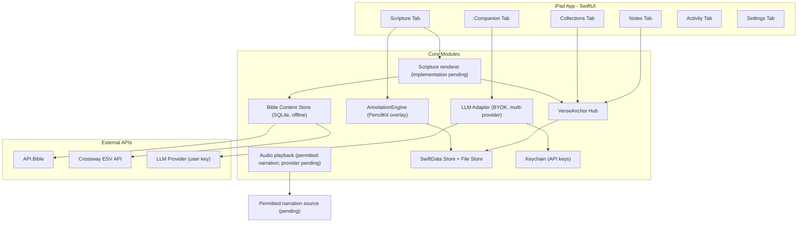

# Technical Design Document — Sophia Scriptura

This is the canonical source of technical intent for Sophia Scriptura. Source files
remain the final implementation truth; when they diverge from this document, update this
document. Status: revised planning draft, 2026-09-29. Technical choices marked proposed
need the linked planning evidence before implementation. The app contains the six-tab scaffold and an isolated SP-006 native canvas experiment;
SP-007 also adds a temporary Collections workspace with in-memory folders and sample
memberships; it does not implement production storage or artifact routing. The broader
design is not implemented. Requirements live in the
[product specification](../product-specification/product-specification.md).

Development follows the [owner-directed AI workflow](../guidelines/ai-structure-guidelines.md).
The owner chooses the next ticket; planning and feedback do not automatically authorize
new feature implementation. Empty standalone contract/diagram templates were removed;
this TDD retains proposed contracts until a selected ticket produces maintained detail.
The reader-specific maintained contract is `docs/data/scripture-reader-contract.md`.

## Full-design reconciliation checkpoint — 2026-09-16

Read the [complete feature map and open decisions](../product-specification/product-specification.md#full-design-reconciliation--review-baseline)
and [whole-app UX](../design/ux-specification.md). SP-001 remains open for design review;
SP-007 is the bounded Collections prototype, whose verification continues separately.
Neither authorizes the remaining production features. The feature map
preserves the full theological brief, topic/translation variety, all Save types, rich
Notes/library features, Activity, Settings/Account and native Pencil palette expectation.

The platform/store/provider choices below remain candidates where labeled proposed.
D-08 now confirms local Settings without a Sophia account, Files backup/restore and
optional backup reminders. D-02 is confirmed: multiple layers with Read Hidden, Read Visible and Draw states;
see §10 for the interaction contract. Native tool-picker integration needs
a separate scoped follow-up; SP-006 does not fulfill REQ-021. Premium and accessibility
acceptance apply throughout delivery, not only in the final milestone.

## 1. Project Goal

Build Sophia Scriptura, a personal, offline-first iPadOS Bible study app for a single
user that unifies scripture reading, Apple Pencil annotation layers, note taking,
verse-anchored collections, a guardrailed AI study companion (bring-your-own-key), audio
playback, and a Bible reading habit tracker — grounded in historic orthodox Christian
conviction.

This is a personal app. It is not distributed on the App Store, has no multi-user
accounts, no analytics backend, and no server component.

## 2. Target User and Primary Workflows

Single user: the owner, doing personal study and discipleship on their own iPad.

Primary workflows:

1. Read a chapter in a chosen translation; switch translations; play audio.
2. Turn on the annotation layer and write over the text with Apple Pencil; optionally
   reveal blank writing space around the centered column.
3. Tap a verse or chapter number to open a popup showing everything anchored to that
   reference (notes, conversations, saved verses, links).
4. Select scripture text and act on it: Copy, Ask, Save, Share.
5. Study a topic with the AI Companion using a guardrailed prompt preset.
6. Draft freeform notes mixing text, ink, images, tables, quotes, and link cards.
7. Organize artifacts into collections (folders).
8. Track reading time and review streaks and analytics.

## 3. System Responsibilities

- Render scripture with per-verse tappable anchors and a custom selection menu.
- Persist all user study data locally and reliably.
- Keep ink annotations spatially aligned per version and chapter.
- Anchor every study artifact to a canonical verse reference for cross-linking.
- Mediate AI requests through a provider-agnostic BYOK adapter without leaking secrets.
- Work offline for bundled content and provider-permitted, unexpired cached content.

## 4. Decision Status

| Area | Decision | Rationale |
| --- | --- | --- |
| Target device | Confirmed: owner's iPad A16 | Owner reports iPadOS 26.6.2 and non-Pro Apple Pencil; exact Pencil model is unknown. Xcode 26.6 was verified locally. |
| Platform | Proposed: native SwiftUI with UIKit/PencilKit bridges | Deployment target follows device confirmation; iPadOS 17+ is the scaffold setting, not a newly approved requirement. |
| Developer account | Proposed: free Personal Team signing | Periodic reinstall is a tradeoff to review; no paid membership assumed. |
| Scripture rendering | Implemented in SP-009: continuous TextKit 1 chapter surface with horizontal chapter swipes | SP-009 must prove continuous scrolling, passage selection and accessibility; annotation geometry remains a later native gate. |
| Scripture visual system | Implemented SP-009 refinement: OldPaper reader/shell and seven persisted color/type presets | Shared presentation tokens and bundled offline OFL fonts implement the [Scripture screen specification](../design/scripture-screen-specification.md). Reader unit/UI evidence is tracked in SP-009; owner visual acceptance is recorded in the 2026-09-29 M2 closure; VoiceOver is waived for that closure. SP-008 physical validation and SP-012 actual-reader behavior are owner-accepted; SP-012 implements annotation storage/recovery. |
| Translations | Confirmed: prioritize free access; prefer NIV, NLT, NKJV, or ESV | WEB is the proposed bundled base; preferred-version availability is not promised. |
| Offline | Proposed: complete permitted base text plus policy-controlled online content | Free access does not imply permanent offline storage rights. |
| Notes | Confirmed: expandable canvas with freely positioned text, ink, and images; explicit grouping | Objects stay independent until deliberately grouped. Growth limits, detailed selection/resize behavior, and export remain open. |
| Audio | Confirmed preference: human narration | Provider/edition rights remain open; TTS is not an approved substitute. |
| AI | Proposed: provider-neutral boundary, one provider first, Keychain secrets | Selected-context online use and source retrieval accepted. Provider/model, source access and numeric cost controls remain open; shared foundation and all four preset wordings approved; runtime and behavior evaluation pending. |
| Storage | Reader slice implemented: immutable bundled SQLite Scripture plus local-only SwiftData reader state; remaining study data stays proposed | The maintained reader contract defines identity, loading and restore behavior. Notes/ink/media and full backup remain SP-005 work. |
| Annotation persistence | Implemented in SP-012: edition/revision + chapter + layer UUID + preserved layout | Versioned generation commits, recovery and ink-only backup follow the annotation contract; owner-reported physical Pencil and restore acceptance closed M3 on 2026-10-03. |

Non-goals: multi-user, cloud sync, App Store release, monetization, Android/web.

## SP-006 implementation checkpoint — 2026-09-15

Closure: owner approved stopping the bounded experiment with documented limitations.
SP-006 is done under revised acceptance; deferred accessibility/gesture checks are
not passes and must be addressed in the corresponding production editor tickets.

The Notes tab now opens a disposable native canvas experiment. A SwiftUI session owns
selection and snapshot history; a UIKit scroll view zooms one shared document surface
containing text, an image, and a transparent PencilKit view. Object positions remain in
document points. Group movement clamps every member by the same delta.

The experimental store is an actor writing one validated, atomic JSON envelope containing
text, geometry, group IDs, drawing bytes, and a generated image. It is deliberately
separate from the proposed production SwiftData/file schema. Revision ordering prevents
late autosaves replacing newer saves; invalid restore input leaves the existing file intact.

Limits: three sample objects, one whole drawing object with a 1,100 × 800 pt ink area,
canvas extent capped at 6,000 pt, 50–200% zoom, 500 text characters, and 30 undo snapshots.
There is no stroke-level grouping, rich text, image import, multi-window coordination,
or full backup implementation. Memory and Pencil behavior require physical-device evidence.
A DEBUG-only `CanvasMemoryProbe` can collect physical footprint metrics with the
explicit `SP006_MEMORY_PROBE=1` flag and a valid `SP006_UI_TEST_FIXTURE` UUID. It
opens the experiment directly, uses the existing isolated fixture path, and records
numeric JSON under `Application Support/SP006/Diagnostics/`. Normal launches keep
the six-tab flow; Release excludes the probe. Synthetic stroke/edit/zoom cycles
measure a bounded workload, not real Pencil gestures or production note capacity.
See [SP-006](../../tickets/SP-006-native-canvas-experiment.md) and the
[iPad walkthrough](../testing/sp006-ipad-guide.md). Production architecture remains provisional.

### Owner-selected shell motion — SP-011, 2026-09-29

The six-tab dock shows on launch/resume, tab interaction and finger panning, then hides
after three seconds of inactivity. A small reveal handle stays reachable. The shell allocates separate vertical regions for content and footer, with 20-point
bottom content clearance for descendant SwiftUI scroll surfaces. This keeps the viewport
stable while hiding/revealing and lets final rows clear the footer. It slides mounted tab surfaces left/right
without recreating their navigation state. A theme-colored selection glow moves between
tabs. Reduce Motion uses a fade. AppShell owns the transient timer and a passive UIKit
finger observer; feature views do not own shell timing or expose provider/content data.
See [SP-011](../../tickets/SP-011-tab-shell-motion.md).

## 5. Architecture Overview

Proposed boundaries below; external Bible adapters are alternatives pending selection,
not a commitment to integrate every provider. YouVersion is also under evaluation.

The diagram shows runtime responsibilities and candidate data sources. It does not
require domain modules to import concrete stores or SDKs; dependency direction is
specified in §5.1.

### 5.1 Recommended implementation structure — architecture review

Status: recommendation for owner review, not approval to refactor or build features.
Use a native Swift app, organized by feature, with MVVM-style presentation and small
application/domain boundaries. Start with one app target; extract local Swift packages
when real reuse or compile-time dependency enforcement warrants them. Do not create
empty packages, protocols or use-case wrappers merely to populate a template.

- **App composition:** constructs concrete dependencies and navigation. Explicit initializer
  injection supplies repositories and provider interfaces; no global mutable service locator.
- **Presentation:** SwiftUI views display state and forward actions to a feature-owned
  screen model/session. UIKit/PencilKit bridges handle rendering and native gestures.
  They do not own database access, provider requests or theological prompt policy.
- **Application:** coordinates meaningful workflows such as Save verse as note or Ask
  about passage. Simple display/local-selection logic stays in presentation; use cases
  are introduced for multi-step rules, reuse or transaction coordination, not every tap.
- **Domain:** value types and rules such as passage identity, annotation layout identity,
  note geometry and grouping. Domain code does not import SwiftUI, SwiftData, PencilKit
  or a provider SDK. Platform drawing data is translated at the editor/storage boundary.
- **Infrastructure:** implements domain/application-owned interfaces for local persistence,
  media files, Keychain, Scripture sources and AI providers. Views never construct it.
  Framework persistence objects do not escape as shared mutable application state.

Compile-time dependency intent (arrows mean imports/references, not runtime call order):
Presentation → Application → Domain; Infrastructure → inner contracts; App → concrete
implementations and composition. A workflow invokes a repository interface at runtime;
the app injects the implementation. Features do not import another feature's views or
screen models. Cross-feature study links use shared passage/artifact IDs and explicit
workflows. Shared code is introduced only for genuinely shared concepts.

Recommended stack: SwiftUI for screens/design system; UIKit and PencilKit for canvas,
Pencil lifecycle and the native tool picker; Swift concurrency for async work; URLSession
behind provider adapters; Keychain for keys; AVFoundation for permitted audio playback.
SwiftData reader preferences and immutable bundled SQLite Scripture are selected by the
[reader data contract](../data/scripture-reader-contract.md). Separate drawing/media files
and the remaining study-data schema stay proposed until their SP-005 slices specify
atomic-save/recovery/migration boundaries. A custom TextKit-backed reader is selected;
YouVersion remains an optional future content integration, not a rendering dependency. Keep
XCTest/XCUITest for the existing test targets. No third-party architecture framework is
required initially; Swift Package Manager manages dependencies only when justified.

State ownership: view-local transient state in the view, screen state in one screen
model/session, durable study state in repositories. UI state is MainActor-isolated;
repository concurrency and background work are explicitly designed. Async calls alone
do not guarantee off-main execution. Cancellation, failed saves and stale responses have
explicit behavior; no force-try persistence or silent data replacement.

For Notes specifically, separate document geometry/grouping and edit history from
viewport/selection state, UIKit rendering/gesture coordination, and media persistence.
Do not grow SP-006's session or controller into an all-purpose editor. The three-object
JSON fixture and whole-drawing snapshot history are experimental, not production contracts.

Maintainability gates: each selected ticket identifies owning modules and a visible
outcome; new I/O crosses an explicit boundary; reusable UI tokens/components live in a
design system; error/cancellation behavior is described; meaningful rule/repository tests
and a small number of UI journeys verify the change. Review actual dependencies and
responsibilities, not folder names or arbitrary line-count limits. Persist architectural
decisions here; add separate ADRs only for substantial tradeoffs that need their own record.

Apple references: [SwiftUI/UIKit bridge](https://developer.apple.com/documentation/swiftui/uiviewrepresentable),
[PencilKit canvas](https://developer.apple.com/documentation/pencilkit/pkcanvasview),
[SwiftData actor support](https://developer.apple.com/documentation/swiftdata/modelactor).

## 6. Module Boundaries

| Module | Owns | Must not own |
| --- | --- | --- |
| `ScriptureRenderer` | Turning cached chapter data into an attributed layout with verse anchors; selection handling; verse-tap hit-testing. | Persistence, networking, AI. |
| `AnnotationEngine` | PencilKit lifecycle, version/chapter/layer/layout binding, surrounding writing space and scroll sync; persistence through an interface. | Verse semantics, note content. |
| `VerseAnchorHub` | Resolving a `VerseRef` to all attached artifacts and creating anchored artifacts. | Rendering, drawing. |
| `LLMAdapter` | Normalizing provider requests/responses and streaming; receives already-built conversation context. | UI state, verse rendering. |
| `AudioEngine` | Playback and playback state for permitted narration; provider remains open. | Content licensing, implicit TTS substitution. |
| `ContentStore` | Offline SQLite scripture store; version metadata; chapter fetch-or-cache. | User study data. |
| `UserStore` | SwiftData models for notes, conversations, collections, saved verses, activity, presets. | Bible text. |
| `KeychainStore` | Secure read/write of provider API keys. | Anything else. |
| `NoteCanvas` | Positioned content, selection, transforms, editing focus, undo, and viewport. | Network calls or direct provider access. |

Start with one app target and feature folders. Introduce local Swift packages only
where a tested boundary benefits from independent compilation or reuse. Empty protocols
in the scaffold are placeholders, not finalized contracts.

## 7. Data Model

### 7.1 Scripture reader identity and locations

The accepted reader slice is maintained in the
[Scripture reader data contract](../data/scripture-reader-contract.md). An edition,
content revision and reference system jointly identify source text. A verse identity
uses that reference system plus a USFM book code, chapter and verse; passage ranges use
ordered interval overlap rather than quotation matching. Explicit source mappings
represent bridges, omissions and other versification differences.

Reader restoration persists an edition/revision-aware source location and an optional
UTF-16 body offset. A display page number is never the sole reading-position key because
pagination can change. If an exact revision or offset is unavailable, restoration falls
back visibly to the nearest valid source passage and never silently switches editions.

### 7.2 Offline Scripture and reader-state stores

SP-009 uses a generated, immutable bundled SQLite resource for the permitted WEBP
snapshot and a manifest containing source, license, checksum and revision metadata.
Normalized edition/book/chapter indexes lead to a versioned `ChapterDocument` payload;
views request it through `ScriptureContentRepository` and never open SQLite directly.
The importer validates the archive checksum, the exact 66-book set, chapter/order rules,
UTF-8 content, deterministic output and license/credit fields before bundling it.

Reader progress and typography/theme preferences are local user data stored through a
separate `ReaderStateRepository`, initially implemented with SwiftData. Replacing the
bundled database must not replace reader state. Restricted future editions require their
own verified retention, quotation, export, TTS, narration and AI-use policy; API access
alone is not permission to retain a full text.

### 7.3 User data (SwiftData)

- Implemented `NoteDocument` (SP-013, 2026-10-01): shared identity/title/tags and deletion,
  with exactly one tagged `NoteContent` payload. Canvas owns positioned objects, including
  movable/resizable drawings and URL cards. Page owns fixed-width flowing text, inline
  citations, inline images/tables and a fixed Pencil overlay above content. Existing v2
  Page floating items remain in `legacyObjects` at their original coordinates; new Pages
  do not create floating shapes or text boxes. Page width/column coordinates remain fixed
  through rotation, viewport resizing and zoom. See [Notes contract](../data/notes-contract.md).
  Notes use validated file generations (v1/v2 readable, v3 saves), not SwiftData. The exact
  pre-upgrade generation is retained as `before-note-types.notes`; existing earlier backups
  remain untouched. Object-only notes stay Canvas and page-backed notes stay Page.
  Pencil input is routed through the common paper ancestor with Scribble suppressed. The
  native supported inking/eraser palette is used, with lasso limited to Canvas. Physical
  on/off-Scribble acceptance remains pending; simulator checks cannot close that gate.
  Scripture visibility is a persisted UI preference; hidden citations reveal the shared
  reader session. Authorized existing translations retain quotation metadata and policy.
- `Conversation(id, title, presetId, createdAt, updatedAt, linkedVerseRefs[], messages[])`
- `Message(id, role, content, createdAt, providerId, modelId)` — role: system | user | assistant.
- `Collection(id, name, createdAt, items[])`
- `CollectionItem(id, kind, targetId | verseRef | url)` — kind: note | conversation | verse | link.
- `SavedVerse(id, verseRef, versionId, snapshotText, kind, createdAt, noteId?)`
  - `kind`: gleaning | bookmark | noteQuote.
- `LinkAttachment(id, url, title, verseRef?, createdAt)`
- `ActivityRecord` — M8 design is specified in
  [Activity and background music](../design/activity-screen-specification.md). Persist
  required title, mode ID/label snapshot, activity date, active duration, source, optional
  actual start/end instants, timezone, pause intervals, optional continuous reading range
  and edition, description, and creation/update times. Built-in/custom mode registry,
  overlap policy, midnight allocation, concurrency, and per-book minute allocation remain
  open; do not ship the earlier `ActivitySession(start,end,source,label)` sketch.
- `ActivityMode(id, name, kind)` — built-in modes are Reading, Studying, Meditating,
  Journaling, Memorizing Verses and Reviewing; user-created custom modes are supported.
  Icon/color fields and whether a custom mode is archived or deleted remain design choices.
- `PromptPreset(id, name, systemInstruction, isBuiltIn, options{...})`

### 7.4 File store

For M3 ink, the [annotation contract](../data/scripture-annotation-contract.md) supersedes
the drawing-path sketch below: stable UUID identities, immutable generations and a
validated atomic manifest commit. Notes/image storage and full-app backup remain proposed.

- PencilKit drawings: `ink/{versionId}/{bookUSFM}.{chapter}.layer{n}.drawing`.
- Note images: `notes/{noteId}/{imageId}.heic`.

Paths above are scaffold-era sketches. Final storage needs layout revision identity,
note/page ink identity, versioned manifests, and recoverable metadata/file commits.
Complete and test export/import before trusting the app with irreplaceable study notes.

### 7.5 Keychain

- One entry per provider: `service = "sophia.llm.{providerId}"`, value = API key.

## 8. External Integrations

### 8.1 Free content strategy and provider evaluation

- SP-002 research baseline: eBible `engwebp`, American-English WEB Protestant edition,
  USFM input, matching the existing 66-book scope. Immutable archive/checksum acquisition
  belongs to ingestion implementation, not this research. See the dated
  [content integration specification](../integrations/scripture-content.md) for evidence,
  capability matrix, remaining questions and reproducible import acceptance plan.
- Acquire permitted text → parse/map source book/chapter/verse identities → render in
  Sophia's own Scripture UI. A provider's ready-made reader is optional, not required.
  Keep content adapters independent of rendering, verse actions and Pencil geometry.
  Offline WEB needs no YouVersion SDK or runtime content API. Personal use is the scope;
  it does not imply every API grants permanent storage of its complete catalog.
- Preferred editions are conditional integrations, not blockers for the base reader.
  YouVersion offers Swift components and API access, but Sophia's app-specific licenses
  remain unverified. API.Bible's current Starter plan advertises three optional copyrighted
  editions; the earlier public-domain-only assumption is superseded. Exact eligibility,
  refresh, quotations, exports and AI rules are recorded in the specification.
- On expiry or unavailable access, explain the state and offer the bundled edition at
  the same mapped reference. Never silently substitute a translation.
- The existing ingestion script is an unimplemented stub with superseded bulk-download
  assumptions. It is not approved tooling for downloading entire copyrighted Bibles.

### 8.2 Crossway ESV API (ESV text + audio)

- Base: `https://api.esv.org/v3`.
- Auth: `Authorization: Token {key}` header.
- Reads: `/passage/text/` and `/passage/html/` for text; `/passage/audio/` for passage
  MP3; `/passage/search/` optional. Long-term audio storage permission remains unresolved;
  avoiding persistent audio initially is Sophia policy, not a verified API prohibition.
- Rate limits: 5,000/day, 60/min for non-commercial personal use. Required copyright
  attribution is shown on the reader and in Settings → About.
- Also enforce the 1,000/hour request limit and storage limit of 500 verses or half
  of any book, whichever is less. Standard access cannot provide a full offline ESV.
  Decide how quotations, conversation passage copies, and exports count toward local
  storage before implementing Save/Ask. Narration storage and timing metadata need
  separate verification; do not promise word/verse synchronization without timing data.

### 8.3 LLM provider (BYOK, provider-agnostic)

- Proposed `LLMAdapter` has a provider-neutral boundary; this sketch is not a final API:
  `send(messages, preset, model, temperature) -> AsyncStream<Token>`.
- Choose one provider for the first implementation after budget/capability review.
  Additional adapters are later work. Verify the selected provider's current API at
  implementation time; map instruction roles and streaming errors explicitly.
- The active provider, model, and temperature are chosen in Settings; the key is read
  from Keychain at call time and never logged or persisted in plaintext.
- Failure handling: surface provider errors to the user verbatim-but-sanitized (no key
  echo), allow retry, and keep the partial assistant message.

## 9. Scripture Rendering and Interaction

SP-003 selects custom TextKit-backed rendering for planning, with TextKit 2 preferred.
The [rendering decision](../design/scripture-rendering-decision.md) governs range mapping,
page geometry, layer lifecycle and transitions, superseding the earlier candidates below.
M2 now uses continuous chapter scrolling under the owner revision below; selection across
long passages remains a native verification gate. Proposed text and page-local PencilKit
surfaces share one viewport transform; independently synchronized scroll offsets are not
selected. Customize selection actions through the UITextView edit-menu delegate.

- A `UITextView` backed by TextKit 2, wrapped in `UIViewRepresentable`. Chapter tokens
  become an `NSAttributedString` where each run carries a custom `verseRef` attribute and
  verse-number runs carry a `tappableVerse` attribute.
- Verse/chapter taps: a tap gesture hit-tests the glyph at the touch point, reads the
  `verseRef` attribute, and opens the anchor popup (Section 11).
- Selection menu: `UIEditMenuInteraction` provides Copy, Ask, Save, Share. The selected
  `NSRange` maps back to a `VerseRef` (or range) via the run attributes.
  - Copy: plain text + reference to the pasteboard.
  - Ask: opens a Companion conversation seeded with the selection + reference, and links
    that conversation to the verse (auto-anchor).
  - Save: prompts for gleaning | bookmark | note-quote, then writes a `SavedVerse`.
  - Share: system share sheet with formatted text + reference.

## 10. Annotation Layer Design

Current M3 decision (2026-09-29): SP-008's fixed continuous chapter geometry is accepted.
The [annotation data/recovery contract](../data/scripture-annotation-contract.md) specifies
source/layout identities, versioned atomic commits, autosave, recoverable deletion and
annotation-only export/restore for [SP-012](../../tickets/SP-012-persistent-scripture-annotations.md).
SP-012 implements this persistence. Page-local proposals below are
historical; the active candidate uses one shared fixed chapter viewport. Exact dimensions
and long-chapter performance must be recorded and verified during SP-012.

D-10 reader direction was revised by the owner on 2026-09-22: one continuously scrolling
chapter, with left/right chapter navigation. Bounded pages are not required for M2. M3
annotation geometry must be revisited before implementation; the earlier page-based
proposal below remains a candidate, not an active reader requirement. If pages are adopted, identity
must retain passage and layout identity, not rely only on a mutable page number.
D-11 requires main tabs at the bottom; native/adaptive behavior and Pencil palette overlap
need validation before implementation. See the UX specification.

- Page-local transparent `PKCanvasView` surfaces use the same viewport transform as the
  text layout. An active canvas does not own an independent scrolling coordinate system.
- Only one layer is visible at a time; layers are toggled hidden/shown. Empty and
  transparent by default.
- Proposed persistence: drawing identity includes version, chapter, layer, and layout
  revision (content revision, font metrics, column width, and margin geometry). Ink
  does not automatically carry across translations. SP-003 selects preserved spatial
  layouts, while passage anchors support navigation and queries. Rotation, larger text, window resize,
  Companion presentation, and extended-margin changes must not silently misalign ink.
- SP-012 owner revision (2026-09-29): Margin exposes blank writing space on all four
  sides of a centered Scripture column; no ruled right-hand column. The toggle changes
  the viewport crop/zoom, never stored text/ink coordinates. Read Hidden uses the ordinary
  centered reader with its current preferences. Annotation controls stay centered and
  compact adaptively. Completed handwriting autosaves; Draw has a compact palette
  affordance that expands the native picker and minimizes again when a stroke starts.
- SP-012 layer revision (2026-09-29): each new layer captures its own layout and reader
  preset/typeface/size. Selecting a layer restores those settings; a deliberate change
  updates that layer's layout while retaining its ink bytes and warning if marks may
  shift. The Layers menu marks selection and shows muted appearance details instead of
  a separate Preserved layouts menu. Draw begins with a compact palette affordance;
  tapping it expands the native picker, and its chevron collapses it to an edge tab.
  Read Hidden has no Margin control or duplicate
  larger-text reading action. Clear Ink is styled as destructive and remains undoable.
- Confirmed D-02 (2026-09-16): multiple independent layers; at most one visible.
  Read Hidden shows no ink, while Read Visible shows the selected layer without accepting
  drawing. Both reading states support passage taps, text selection/actions and listening.
  Draw enables the native Pencil palette and finger navigation, pauses Scripture text
  selection and verse/chapter taps, and allows existing audio to continue.
- Separate selected-layer identity from interaction state. Hidden layers retain content;
  new layers are empty/transparent. Test gesture ownership, input transitions and undo.
  Layer lifecycle is specified by SP-003; persistence/recovery remains SP-005 and native
  validation remains SP-008. Preserve the original layout when text reflows.

## 11. Verse Anchor Hub

- `VerseAnchorHub.attachments(for: VerseRef)` returns notes (via quote blocks),
  conversations (via `linkedVerseRefs`), saved verses, and links anchored to that
  reference, powering the verse-tap popup — the core organization/accessibility feature.
- Anchors are stored on the artifacts themselves (verse ref strings), so the hub is a
  query layer, not a separate source of truth. This keeps references shared across all
  translations.

The query contract must also return collection memberships and deduplicate results.
Chapter queries and overlapping passage ranges cannot be implemented as string equality.
Select indexed relationships versus embedded references when the data contract is written.

## 12. AI Companion Guardrails

- Every conversation is created from a `PromptPreset`. Built-in presets seed from
  `shared/prompt-presets.seed.json`: Biblical Studies, Christian Living, Apologetics,
  Tough Questions. Each carries the owner's orthodox study instruction (orthodoxy lens,
  original-language analysis when crucial, hermeneutics/exegesis with Scripture
  interpreting Scripture, historical-cultural context, tradition comparison where
  relevant, named proponents, APA references, and optional concision).
- Seed revision 2 in `shared/prompt-presets.seed.json` retains owner-approved revision-1
  wording: shared
  Christian foundation plus Biblical Studies and Christian Living. Apologetics and Tough
  Questions wording in revision 2 is now also owner-approved. No instruction text changed at approval.
- Future integration must resolve `{{sharedGuardrail}}` exactly once in the selected
  `systemInstruction` and send the composed context in the provider-supported instruction
  role on every request, including follow-ups. Never transmit the unresolved placeholder.
  There is no runtime consumer or provider integration yet; approval is for wording only.
- Presets are user-editable in Settings; edits never delete the built-in defaults
  (defaults can be reset).
- ASK-from-scripture injects the selected passage and reference into the first user
  message and auto-links the conversation to the verse.
- Proposed reliability requirements: snapshot preset version per conversation; distinguish
  retrieved evidence from model recollection; never invent citations, claim a search
  without retrieval, or present model output as divine revelation. APA formatting is
  not proof of source validity. Preserve the owner's theological intent with a reviewed
  foundation and explicit handling of differences between Christian traditions.
- A prompt does not provide browsing or commentary access. Retrieval, source licensing,
  and provider costs remain open. Explain the passage/note context sent off-device;
  include only deliberately selected context. Review seed prompts before using them.

### 12.1 Conversational memory — requirement confirmed; architecture proposed

REQ-024 confirms contextual follow-ups and clarifications. This is conversation-scoped
state, not a promise of perfect recall or automatic learning about the user across chats.
It does not require a Sophia server or provider-hosted conversation storage.

Proposed responsibilities:

- Conversation store: persist ordered user/assistant messages, passage references, selected
  edition/context, resolved preset snapshot/version and relevant source metadata locally.
  New conversations have separate identity and history. Storage/retention must respect
  Scripture/source permissions; local history does not authorize retaining restricted text.
- Request context builder: compose the active instruction snapshot, selected passage,
  relevant prior turns and current question before the provider call. Treat messages,
  retrieved documents and generated summaries as content, not instruction authority.
  Do not include unrelated conversations, private notes or the entire library implicitly.
- Provider adapter: translate the composed request into the selected provider's supported
  message roles and context limits. A new API call must not be assumed to remember earlier
  requests automatically. SP-016 selects the multi-adapter BYOK boundary and local
  context-composition contract; each implementation ticket rechecks its provider's current
  API and model capabilities.
- Long conversations: reserve room for the answer and current question; preserve recent
  turns and important explicit corrections, using provenance-linked summaries or selected
  older messages when history exceeds the context budget. Summaries are lossy and may be
  wrong; keep original permitted history available and ask for clarification when an omitted
  detail matters. Never imply the model received every saved message. Do not preserve a
  deleted message through an old summary; invalidate/rebuild derived memory when needed.
- UI/session state: closing the panel, maximizing to the tab or reopening the app retains
  the same conversation. Show failed/partial replies explicitly; retry must not duplicate
  turns. Pin the instruction version for an existing conversation rather than silently
  changing its foundation when defaults are edited; explicit context changes need a policy.

Candidate acceptance scenarios (not executed): ask about John 3:16 and follow with “What
about verse 17?”; refer to a previous argument; correct an earlier assumption and ask again;
reopen the conversation; start another conversation and confirm isolation; exceed the
context budget; retry an interrupted response; delete content and verify it is not used
from derived memory. Conversation-range ambiguity should prompt clarification rather than
an invented reference. Cross-chat memory and automatic profiling are not selected scope.

### 12.2 Approved remaining presets

Apologetics has approved wording emphasizing defense of Christian faith and teaching
sound argumentation, without fabricated credentials or a win-at-any-cost approach.
Tough Questions has approved wording emphasizing fair examination of major competing
positions, including relevant non-Christian perspectives, evidence weighting and uncertainty.
It remains transparent about the shared Christian foundation rather than claiming freedom
from all bias. Both inherit the approved shared guardrail; both are owner-approved. No request, retrieval integration or model evaluation ran for these prompt edits.

### 12.3 Quiz Me — owner-approved planning baseline

REQ-025 adds Quiz Me as a structured mode within Companion, separate from ordinary chat
turns. The approved types are Identify the Verse (a passage of up to three verses),
Complete the Verse, Scripture or Cap, Who Said It?, Christian History from Bible history
through the early Church, Bible Quiz (a biblical question with choices), and Bible or False
(a biblical statement judged true or false). Identify the Reference was removed because it
duplicated Identify the Verse. Difficulty
presets are Easy (10 questions at 1 point each), Average (5 at 3 points each), and Difficult
(3 at 5 points each). Timed and untimed sessions are requested. The question appears in a
centered card; after an answer the session explains correctness, records the result, and
continues. Quiz history retains session results and per-question history locally.

Use distinct logical concepts for a Quiz session, its question/answer key and source metadata,
and the user's attempt/result. The selected provider now generates the structured question,
choices, provisional answer key, explanation and cited reference. The app validates the JSON
shape, requested type order, count, answer-choice bounds, within-session uniqueness and exact
recent repeats before opening a session. It does not independently establish the factual truth
of a model-authored key, so setup and answer feedback disclose AI provenance and surface the
cited reference. Do not transmit full licensed Scripture text to a provider unless its content
rights permit that use.

Quiz Me is launched and reviewed in Companion. Answer controls and structural validation are
defined in the [Companion design](../design/companion-screen-specification.md). Model-authored
keys are used for provisional scoring and must carry a Bible reference or concise primary
historical source. Factual verification against local permitted Scripture and inspectable
Christian History sources remains a quality gap; the UI must not represent an AI key as
independently verified.

Question selection is provider-generated and locally cached under SP-019. Each selectable
type targets 20 Easy, 10 Average and 6 Difficult prepared questions, enough for two
single-type quizzes. Refill first makes each bucket playable, then builds spare capacity.
Starting a quiz uses available cached questions immediately; starting, completing and
quitting request in-app reconciliation. A first or depleted quiz waits for provider
generation. Active warmups incorporate new priorities at a batch boundary, and failures
use bounded in-app backoff without discarding cached items. Every request includes a
random nonce; recent full question text is no longer sent as prompt padding. Local exact
and strong word-overlap checks reject repeats against cached and historical questions.
Easy targets direct, widely
known recall; Average requires broader contextual recall and plausible related distractors;
Difficult requires precise canonical context, less-prominent details or close reading without
ambiguity. The provider must return the complete missing set before a cold quiz opens. Semantic
near-duplicate avoidance, factual correctness and perceived difficulty still require real-
provider evaluation.

Untimed is the default. Timed mode uses per-question limits of 60 seconds for Easy, 45 for
Average and 30 for Difficult; background/system interruptions, between-question transitions
and feedback pause the timer. Expiry records Unanswered and awards zero without hiding the
explanation. Results show points and percentage without speed bonuses. Complete the Verse
normalizes case, surrounding punctuation and repeated whitespace while keeping Nearly
correct distinct from exact Correct.

Quiz history, deletion and recovery follow the
[Companion contract](../data/companion-contract.md). Every quiz completed through all its
questions and final summary creates a linked Reviewing record; active question time counts
toward the normal Activity goal and streak. Abandoned sessions do not create one
automatically. Deleting Quiz history retains its already recorded Activity time. Activity stores duration/date,
mode/title and quiz-session ID only; Quiz history owns correctness, answers, score, sources
and explanations. This is approved design scope, not runtime implementation authorization.

### 12.4 Multi-provider BYOK — owner-approved planning baseline

Sophia supports multiple configured providers through compatible adapters. The intended
first adapters are OpenAI, Anthropic and Gemini; a custom OpenAI-compatible endpoint follows.
This does not promise automatic compatibility with arbitrary APIs. Each conversation pins
one provider, model, capability snapshot and resolved preset snapshot. Switching provider
creates an explicit branch after disclosing the context copied; it never silently mutates
the existing conversation.

Local history is authoritative. `LLMProviderAdapter` normalizes streaming text, sources,
tool activity, usage, completion, refusal, interruption and failure while preserving
provider-specific payloads inside Infrastructure. Capabilities are advertised rather than
assumed. Provider-side continuation identifiers may optimize a request but never replace
local messages or context composition. See the
[Companion data contract](../data/companion-contract.md).

Only displayed, deliberately selected context leaves the device. Local Scripture retrieval
and answer keys remain Sophia-owned and permission-aware. Provider retrieval is optional and
must return inspectable evidence; otherwise the UI states that no external sources were
retrieved. Keys are stored per provider/account in Keychain and excluded from records, logs,
diagnostics and exports.

## 13. Audio, Activity, Settings

- Audio: human narration preferred where permitted; on-device `AVSpeechSynthesizer`
  only for content whose permissions allow it. Share playback state with the reader;
  synchronized verse highlighting depends on actual timing data. Test interruptions,
  screen lock, chapter completion, and missing voices/audio on the owner's device.
- Activity: the owner-approved M8 behavior, data shape, metrics, Reading workflow and open
  decisions are maintained in the [Activity design](../design/activity-screen-specification.md).
  The screen offers Reading, Studying, Meditating, Journaling, Memorizing Verses, Reviewing
  and custom modes; only Reading automatically routes to Scripture. Reading stores one inclusive
  continuous reference range, including cross-book ranges, with separate records for
  disconnected passages. Starting highlights the initial verse temporarily; finish requires
  an ending verse. A session survives backgrounding/relaunch, pauses/resumes, and computes
  active duration excluding pause intervals. Manual records require title, mode, date and
  duration; optional actual start/end clock times derive duration automatically.
- A completed Activity record has required title, mode, activity date and duration, with
  optional wall-clock range, description, and structured reading range/edition. Suggested
  local metrics are daily/weekly/monthly active minutes, mode totals, configurable daily
  goal, and current/best streak. The default goal and streak threshold are both ten active
  minutes per local calendar day; completed timer and manual records count. Counting custom
  modes under the same rule is proposed, not explicitly decided. Per-book time needs an
  owner-approved allocation rule because an overall duration
  and a cross-book range do not reveal time spent in each book. Overlaps, simultaneous
  timers, midnight attribution and custom-mode deletion are also open; no silent double
  counting or fabricated allocations.
- Background music is human-composed instrumental ambient lo-fi without vocals. It is
  separate from Activity timing and Scripture narration, starts only on explicit Play, and
  continues across tabs/background/screen lock. Starting Scripture narration pauses music;
  explicitly resuming music pauses narration. One collapsible shell cluster shows only
  services that are currently in use and disappears when neither music nor an Activity
  session is active, paused, or awaiting completion. Bundle only individually rights-checked
  recordings; preserve track provenance and license evidence. The CC0 deed is a candidate
  rights framework, not evidence that any specific recording is cleared. See the Activity
  design for shell behavior and remaining track decisions.
- SP-020 Activity implementation currently uses a separate local Activity-v1 JSON envelope
  with checksum, previous-file recovery and Activity-only Files export/restore. Its one
  persisted timer draft records active intervals; `RootTabView` owns the cross-tab timer
  presentation. `CompanionSession` remains the source of quiz results and publishes a
  lightweight Reviewing link imported once by Activity. Activity reminders, including each
  one-time reminder's cleanup choice, are persisted with the Activity snapshot and scheduled
  through local iPad notifications. Activity also persists per-mode daily goals, migrating
  the former total goal to Reading and summing active mode goals for the total threshold.
  Analytics PNG
  export renders the complete selected chart range. See SP-020 for incomplete
  acceptance and physical-device verification. M7 narration is postponed by owner decision.
- Settings (fills the idea's gaps): theme mode; font family/size/line spacing;
  default translation; red-letter toggle; TTS voice and speed; AI provider + key + model
  + temperature; prompt-preset editor; data export/import; storage usage; cache refresh;
  About/attribution; and a Background Music library with track/playback controls.

## 14. Security Constraints

- API keys live only in Keychain; never in source, logs, SwiftData, or exports.
- Data export excludes secrets; it packages user study data and drawing files as a zip.
- Validate external input (API responses, pasted URLs) before rendering or storing.
- LLM/provider errors are shown without echoing the key.
- No secrets are committed; `.gitignore` excludes any local key material and generated
  content databases.

## 15. Quality and Testing Expectations

These are planned checks, not reports of passing tests.

- Unit-test: verse-reference parsing/formatting and ranges; content-store fetch-or-cache;
  LLM adapter request mapping and streaming normalization; anchor-hub queries.
- UI-test: tab navigation, verse tap popup, selection menu actions, annotation toggle.
- Manual test cases in `tests/` and `docs/testing/test-specification.md` cover offline
  reading, ingestion limits, and audio.
- See `AGENTS.md` → Verification Commands for the exact `xcodebuild` invocations.
- Verify freeform geometry and attachments survive reload, undo, and export/import;
  test damaged imports without replacing intact user data. Test content-policy expiry
  with injected dates and no live credentials. Measure Pencil feel and canvas memory
  on the actual iPad A16, including long notes and large images.
- Accessibility includes VoiceOver element order on the freeform canvas, larger text,
  keyboard access, contrast, reduced motion, and labeled selection/edit controls.

## 16. Deployment Assumptions

- Proposed: free Personal Team signing on the owner's Mac. Provisioning expires after
  7 days; review reinstall and backup workflow before daily use. Paid membership has
  not been requested. See [Apple account guidance](https://developer.apple.com/help/account/basics/about-your-developer-account).
- No CI/CD, no server, no store submission. Data safety relies on periodic manual export.
- Verified 2026-09-14: Xcode 26.6 is installed at `/Applications/Xcode.app`; the default
  developer directory points to Command Line Tools. A command-scoped `DEVELOPER_DIR`
  selected full Xcode for version inspection. No successful app build is recorded.

## 17. Out-of-Scope Behavior

- Multi-user accounts, cloud sync, sharing between devices.
- Commercial distribution or monetization.
- Editing or redistributing licensed Bible text beyond personal on-device use.
- Non-iPad platforms.

## 18. Risks, Evidence, and Next Decisions

Outstanding: exact Pencil model, canvas growth limits, detailed selection/resize behavior, canon scope,
content entitlements, layout persistence, signing choice, AI budget/provider, and exact
backup format. Track these through the [development plan](../development-plan/development-plan.md).
The owner is learning native Apple development; each ticket must explain the relevant
framework concepts and include a reproducible demonstration.

Primary evidence checked 2026-09-14 (recheck before integrating a provider):

- [iPad A16 specifications](https://support.apple.com/en-gb/122240): supports Apple Pencil USB-C and first generation; actual owned accessory remains unknown.
- [WEB publisher](https://ebible.org/details.php?id=eng-web): public-domain text and edition details.
- [YouVersion Swift SDK](https://github.com/youversion/platform-sdk-swift): official native integration candidate.
- [API.Bible editions](https://docs.api.bible/guides/bibles/) and [terms](https://api.bible/terms-and-conditions): access and content restrictions.
- [ESV conditions](https://www.esv.org/api/): standard noncommercial use and cache limits.

## Owner answer integration — 2026-09-16

The product specification's Q1–Q12 register governs the newly confirmed product choices.
Use warm-paper/book-like styling; nested topic collections and shared memberships; intact
Scripture quotations with separate commentary; direct canvas text editing, plain/ruled/grid
backgrounds and card/list note library. These choices are not implemented by the prototype.

Companion may send deliberately selected context online and retrieve sources. The owner
has no numeric spending ceiling selected; this is not permission to purchase access or
create provider accounts. Provider-neutral boundaries, privacy handling and source
verification still need technical contracts. The owner supplied both samples and approved their refined shared foundation and two
presets. A specific confession/source whitelist remains unselected; runtime integration and
behavioral evaluation are future work.

Files export/import and optional reminders are approved product requirements, not an
implemented backup mechanism. Preferred visible feature sequence is Scripture, annotations,
Notes, Collections, Companion, audio, Activity. The revised M0–M9 roadmap maps feature delivery to M2–M8 in that order; M0/M1 handles
planning/feasibility and M9 integrated acceptance. Phase boundaries and implementation
tickets require owner review before coding resumes.

## SP-009 implementation evidence

The M2 reader is under implementation and acceptance. See [reader evidence](../testing/sp009-reader-evidence.md) for the exact source snapshot, checks, remaining design gaps and physical gates. The first renderer uses TextKit 1 with a chapter-wide UTF-16 map; this is not a failed TextKit 2 experiment or an accepted M3 annotation layout. Scripture content and reader metadata are implemented; the remaining study-data sketches remain proposed.

### Owner reader revision — 2026-09-22

After physical testing, the owner reported bottom-scroll bouncing and requested continuous
chapters, horizontal chapter swipes and removal of the duplicated top book/chapter title.
M2 now uses one continuous UITextView with no exclusion bands or page counters. Chrome
height stays fixed during scrolling. Left swipe advances, right swipe
goes back; active text selection suppresses chapter swipes. Existing Previous/Next controls
remain accessible alternatives. Location remains in navigation controls and the footer.
No reader-state migration or content change is needed. See SP-009 for verification.

### Compact passage navigation — 2026-09-22

The owner's next M2 revision replaces three independent selectors with two compact buttons:
current book/chapter (for example Genesis 1) and Version (WEB). A navigation sheet drills
through searchable Books → Chapters → Verses, with native Back, cancellation and a Read
chapter shortcut. Previewing choices does not mutate or save the current passage. Verse
choices come from the bundled chapter's mapped verse numbers, independent of scroll position.
The topmost visible verse remains an internal restoration anchor, not a displayed progress
counter. Selecting a verse briefly colors its complete mapped body and label for 1.5 seconds;
notes/headings and neighboring verses are excluded. A subsequent jump clears the previous
focus. This is transient rendering, never saved highlighting or native text selection.
The redundant branding/collapse row and its Settings toggle are removed. The serialized
controlsExpanded preference is retained for backward compatibility but no longer affects UI.

### Licensed-edition account verification — 2026-09-22

Owner selected NIV, NLT and NKJV. Authenticated API.Bible catalog checks confirmed NIV11,
NLT and NKJV metadata access. Full-edition downloads remain unresolved: section 8's
systematic-extraction restriction must be reconciled with section 11's conditional offline
storage requirements. A 30-day refresh policy alone is not bulk-download authorization.
See [content integration evidence](../integrations/scripture-content.md#authenticated-edition-verification--2026-09-22)
and its unsent permission-request draft. No licensed Scripture text has been downloaded
or installed, and no runtime provider integration is claimed.

### SP-010 licensed offline translations — 2026-09-23

The owner later supplied explicit API.Bible approval for full offline caching of NIV11,
NLT and NKJV for this personal iPad app, with a 30-day validation/sync requirement and
later approval for unlimited personal Copy/Share and text extraction. This is recorded as
owner-supplied correspondence, without independent verification. SP-010 implements an
authenticated direct client, validated typed chapter parser, staged download/resume,
device-only Keychain credential/key storage, and AES-GCM-encrypted chapter payloads in
protected app storage. Each lease locks licensed text on expiry, revocation or detected
clock rollback; WEB remains readable. The user enters the credential on the physical iPad,
then starts the download in Versions. No provider secret or licensed chapter text is in
source control.

### SP-010 development-period exception — 2026-09-29

The owner supplied written API.Bible authorization for Sophia Scriptura to retain encrypted
NIV11, NLT and NKJV copies beyond the standard 30-day refresh period during development,
testing, debugging and application rebuilds. This exception is scoped to development and
does not authorize permanent production caching or distribution. Debug builds use the
exception; Release and Archive builds continue to enforce the 30-day lease. Revocation,
clock-rollback detection, encryption, attribution and secure local storage remain required.

### SP-010 manual sync correction — 2026-09-29

Licensed-edition synchronization is owner-initiated only. App launch, foreground resume,
status refresh and near-expiry checks must never call API.Bible sync endpoints. The owner
uses the explicit per-edition Sync button or **Sync all three now** when choosing to renew.
The provider abbreviation NIV11 remains part of account/catalog evidence; Sophia presents
that edition as **NIV** without changing its stable API.Bible ID or redownloading content.

### Cached access recovery — 2026-09-29

Debug builds honor the owner-supplied development authorization for existing encrypted
NIV11, NLT and NKJV copies even when an earlier denied sync set the legacy shared
access-block flag. Failed API requests still fail; they do not invalidate these separately
authorized development copies. The flag is retained and enforced by the standard policy
in Release/Archive. Missing or invalid encrypted content and clock rollback still block
access. Opening cached translations does not start a sync or download.

## M4 implementation update — SP-013, 2026-09-29

The Notes tab now uses production UUID documents and arbitrary positioned objects rather
than opening the SP-006 sample. The [Notes contract](../data/notes-contract.md) governs
geometry, flat grouping, native-lasso scope, limits, source quotes, tombstone deletion,
integrity-checked generation storage, previous revision recovery and Notes-only Files
backups. Core values do not depend on PencilKit. Infrastructure validates native media;
the presentation session serializes saves and retains dirty state on failure. UIKit owns
one zooming document viewport, direct text editing and selected-object PencilKit surfaces.
Rich object support includes bounded editable tables, links, shapes, bullet/numbered text,
and preserved WEB Scripture quotes with separate commentary. Licensed source text stays
out of Notes and its JSON backups pending edition-specific saved-quote/export permission.
Group/ink scaling, nested groups,
PDF pagination and M5 membership are excluded. Physical quality/capacity/Files acceptance
remain in [SP-013](../../tickets/SP-013-freeform-notes.md); implementation is not M4 closure.

## SP-013 owner-selected fixed Page implementation — 2026-09-29

The owner replaced the prior object-canvas interaction model with a fixed-width growing
page: central flowing text, a Pencil layer intended above all content, and movable/resizable
floating objects. The owner later reported Pencil-to-text routing and typing-exit failures;
the intended Pencil behavior is not physical acceptance. Fingers navigate and manipulate
objects. A full Scripture pane remains visible beside Notes. Citations navigate that pane and
selected passages insert into new/current notes. New notes are ungrouped with no required
Journal/Reference type. The owner confirmed personal-noting translation permission; this
supersedes the earlier WEB-only note restriction. See the current [design](../design/notes-screen-specification.md).
The unsupported-data/crash report is not yet confirmed by reproduction. M4 remains in
progress pending redesign verification and physical acceptance. Companion save integration
remains deferred until Companion exists; normal clipboard paste is available.

## SP-013 Canvas/Page split — owner-selected implementation 2026-10-01

New Note offers Canvas or Page. Canvas has text/drawing/image/table/shape/sticker/quote
objects and HTTP(S) cards. Page has a flowing body, inline HTTP(S) links and Scripture
citations, inline images/tables and immovable page-coordinate ink. Both remain in one
ungrouped-capable library with shared recovery and quote authorization.

Separate Canvas/Page surface controllers share the proven viewport, finger manipulation
and Pencil input plumbing. Canvas reconciles the edited PencilKit scene back into framed
ink objects; Page persists a single overlay. Text-input Scribble is suppressed and the
Pencil drawing recognizer observes the common paper ancestor, including touches over text.
The Scripture pane defaults visible, remembers visibility across launches, and preserves
ReaderSession while hidden. A citation reveals it before navigation.

Schema v3 stores one typed payload. Prior page data infers Page; object-only content infers
Canvas. The original generation is preserved before upgrade, without automatic conversion
or removal of old backups. Inline attachments use UTF-16 object-replacement anchors that
follow body edits; fixed ink does not follow edits. Canvas still has the existing 12,000-point
safety bound; this is not an unlimited or complete Apple Freeform implementation. Image/ink
payloads dominate storage, and dense Canvas performance needs physical measurement.
See the [implementation design](../design/notes-screen-specification.md#implementation-plan)
and [SP-013 ticket](../../tickets/SP-013-freeform-notes.md) for evidence and pending acceptance.

## SP-013 workspace refinement — 2026-10-01

Owner selected the eleven Canvas/Page UI corrections after testing the split build.
Both editors use compact insertion controls, direct title renaming and an options menu
for paper, tags and save status. The former footer, Objects list and Done typing button
are removed. The shell dock floats above all six tabs without reserving a footer. Notes extends
through the bottom safe area; library/settings scroll content has clearance to make its
last rows reachable. Shared AppTheme paper/ink colors cover the status/navigation region
and body, including Collections, instead of separate system black/white surfaces.
Canvas exposes the bounded 12,000-point workspace, visible-area insertion and zoom/fit
controls. Selection shows contextual edit/duplicate/delete, color/shape and arrange/group
actions. Unselected drawings have no object border. Shape and emoji sticker galleries
replace single-placeholder insertion; text boxes can use a sticky-note background.
Paper choices include dots. Page body coordinates and column width remain fixed.
Black/white ink follows appearance while chromatic ink keeps its color. Theme-only
presentation changes do not dirty or rewrite stored drawings; subsequent drawing edits
encode canonical neutral black, which PencilKit adapts on display. Raster previews render
inside the selected light/dark trait environment; pre-converting to white would cause
PencilKit to invert it a second time. A full dark → light → dark regression checks pixels.
Canvas HTTP(S) cards fetch bounded LinkPresentation metadata on insertion/explicit refresh,
cache available downsampled thumbnails with the object, and show a domain fallback when
metadata is unavailable. Page links remain inline. Fetching a preview contacts the supplied
site and its metadata resources; ordinary reopening uses the cached data without refetching.
See the Notes contract and SP-013 ticket for validation and acceptance evidence.

### SP-013 bounded ink viewport — 2026-10-01

The owner reported delayed Canvas strokes followed by app exit. The iPad's 09:22 Jetsam
report records SophiaScriptura terminated for `highwater` at 228,182 × 16,384 resident
bytes (about 3.48 GiB). Notes previously sized the PencilKit view to the entire document.
The live PKCanvasView now stays screen-sized above the document scroll view; its native
zoom, content size and offset follow the document viewport. Saved drawings retain document
coordinates, object ownership and v3 storage. Stroke start no longer reconfigures the
tool picker. The Notes pen button is solid while tools are active and hollow when hidden.
This indicator does not disable the established always-available Pencil input.

### SP-013 Page viewport recursion correction — 2026-10-01

The bounded live ink viewport is itself a `UIScrollView`. Its synchronized offset used to
re-enter the Notes document scroll delegate, causing a recursive Page-opening crash. The
delegate now accepts scroll and zoom events only from the document viewport. The live ink
view can still synchronize to it, while Page coordinates and persisted drawings remain
unchanged.

### SP-013 M4 closure — 2026-10-01

The owner accepted the corrected Canvas and Page workflows on iPad. Scripture's text
selection and verse hub now save a permitted passage into the currently open note without
another decision. With no note open, Sophia asks whether to create a Page, create a Canvas,
or choose an existing note; Page inserts an inline citation and Canvas inserts a quote
object. The reader no longer shows transient annotation save/undo messages or repeats the
book/chapter beneath the reader. The floating tab selector now hides after three seconds.
This closes M4/SP-013; M3's separate actual-reader annotation acceptance remains open.

## SP-014 shared Pencil refinement and app identity — 2026-10-01

Production Notes and Scripture annotations share a presentation-layer Pencil refinement
component. A Pencil-only endpoint pause marks the single new stroke as eligible; conservative
geometry recognizes a line, arrow, ellipse, rectangle or a bounded polygon/star set and
replaces only that stroke inside the existing `PKDrawing`. Feature controllers retain undo,
viewport and persistence ownership. Unsupported or ambiguous input stays unchanged, and no
new storage schema is introduced. Notes' bounded native palette now retains the ruler.

The app target's existing `AppIcon` setting is fulfilled by a universal asset set using
the owner-supplied default, dark and tinted artwork. Clear system treatments are derived by
iPadOS rather than represented as unsupported asset-catalog roles. See SP-014 for automated
evidence and the remaining physical Pencil/icon appearance checks. This work does not start M5.
